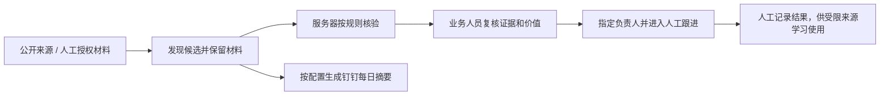

# QwenPaw Relative：项目与贡献说明

本仓库展示蒋心逸在实习期间围绕 QwenPaw 完成的业务应用探索：从数据清洗和多用户隔离，到小红书热点采集，再到徐州招商信息工作台与独立业务页面。项目开发中使用了 AI 编程助手协作；蒋心逸负责提出和澄清业务需求、参与方案与交互设计、组织迭代、验证结果及部署交付。提交历史记录了代码变化，不应把仓库中的每一行代码都理解为本人手写。

## 一眼看懂：原有基础与本项目新增

| 方面 | QwenPaw 原有基础 | 本项目的扩展和适配 |
| --- | --- | --- |
| 智能体平台 | 智能体运行、模型接入、聊天、工作区、插件和 Skill 机制 | 理解并复用平台接口，增加业务插件、工具及适配代码 |
| 用户与权限 | 提供原有认证、工作区和服务端路由基础 | 完善登录、注册和管理员用户管理；引入 `Principal`、资源归属检查及跨账号隔离测试 |
| 数据处理 | 提供工具和文件处理基础 | CSV 去重、缺失值填补、Z-score 异常值处理及 Excel 导出原型 |
| 小红书热点 | 提供插件、定时任务、工作区和对话基础 | 接入第三方公开热榜，校验并留存快照，生成个性化简报与 Excel；人工确认后可发送邮件 |
| 徐州招商 | 提供插件加载、聊天、通道和调度基础 | 新建招商线索与证据台账、共享团队授权、人工复核、受约束的来源学习、关系展示和业务页面 |
| 钉钉 | 原有钉钉通道及消息基础设施 | 增加固定接收会话的“今日新增动态”日报与失败重试规则；需管理员自行完成通道和会话配置 |

这里的“学习”是根据已记录的人工判断和结果，按配置调整来源阅读顺序或提出来源配方建议；它不是重新训练大模型，也不能自行创建事实、改写证据或联系企业。

## 主要工作与代码入口

1. **数据清洗原型。** [`csv_cleaner.py`](../csv_cleaner.py) 使用 pandas 读取 CSV，处理重复行、缺失值和部分异常值，导出 Excel。对应早期提交 [`d2f8e7b3`](https://github.com/CatHissesJustWannaPlayWithU/QwenPaw_Relative/commit/d2f8e7b3ea720bb68bcbd494b7c1de574f789422)。
2. **多用户能力。** 在原有认证基础上完善前后端登录、注册及用户管理，并围绕智能体、会话、文件等资源增加归属校验。入口包括 [`src/qwenpaw/app/principal.py`](../src/qwenpaw/app/principal.py)、[`src/qwenpaw/app/auth.py`](../src/qwenpaw/app/auth.py) 和 [`src/qwenpaw/app/routers/`](../src/qwenpaw/app/routers/)。历史节点：[`31a28735`](https://github.com/CatHissesJustWannaPlayWithU/QwenPaw_Relative/commit/31a28735b36d0876d320451239dcacb12703dcc5)、[`4eda63f5`](https://github.com/CatHissesJustWannaPlayWithU/QwenPaw_Relative/commit/4eda63f5)。
3. **热点智能体。** [`plugins/tool/xhs-hotspot/`](../plugins/tool/xhs-hotspot/) 实现热榜获取、排名和标题校验、原始与规范化快照、摘要和 Excel；定时采集使用固定工具任务，邮件发送需人工确认。第三方数据源的可用性、限流和使用规则可能变化。
4. **徐州招商工作台。** [`plugins/tool/xuzhou-investment-ledger/`](../plugins/tool/xuzhou-investment-ledger/) 包含来源发现、页面材料、证据及线索、团队共享、人工判断、报告、来源学习和审计。工作台 UI 的源代码位于 [`frontend/src/index.ts`](../plugins/tool/xuzhou-investment-ledger/frontend/src/index.ts)，插件版本为 **0.43.2**。
5. **独立业务页面。** [`xuzhou-business-portal/`](../xuzhou-business-portal/) 面向非技术人员，提供聊天、材料查看、业务审核、用户与团队管理入口和页面内手册。它复用 QwenPaw 的服务端接口、账号和台账，不是另一套独立后端。
6. **定时简报和交付。** [`dingtalk_daily_digest.py`](../plugins/tool/xuzhou-investment-ledger/dingtalk_daily_digest.py) 及其 API、[`src/qwenpaw/app/crons/executor.py`](../src/qwenpaw/app/crons/executor.py) 中的适配支持固定会话日报、发送结果记录和受控重试。版本化部署、备份、健康检查及回滚用于降低交付风险；具体生产环境配置和数据未放入本仓库。

## 业务如何运转



机器负责发现、留痕、按规则核验和提示；业务人员负责判断价值、核对、决定是否跟进并记录结果。网页快照不是正式事实，入证或纳入跟进池也不代表企业已同意投资、签约或落地；系统不自动对外联系企业。

## 本地查看与构建

请先按照下方保留的 [QwenPaw 原版说明](../README.md#original-qwenpaw-documentation) 准备 Python 环境和启动服务。本仓库源码以 QwenPaw `2.0.1b1` 附近的代码为基础；徐州插件声明支持 QwenPaw `>=2.0.0, <2.1.0`。对其他版本的兼容性尚未逐一验证。

徐州工作台的编译产物不纳入 Git；安装插件前，先在该目录构建：

```bash
cd plugins/tool/xuzhou-investment-ledger/frontend
npm ci
npm run typecheck
npm run build
```

然后返回仓库根目录，在已配置好 QwenPaw 的环境中安装插件：

```bash
qwenpaw plugin install ./plugins/tool/xuzhou-investment-ledger
```

如已安装同名插件，请先参考 [`插件命令说明`](../src/qwenpaw/cli/plugin_commands.py) 和自己的备份流程。独立业务页由同一个服务挂载在 `/business/`，并调用现有后端 API；账户需同时具备相应平台和徐州团队权限。小红书插件的配置见[插件说明](../plugins/tool/xhs-hotspot/README.md)。

仓库不包含生产账号、密钥、钉钉会话绑定、真实业务台账或采集快照。新环境需要自行设置账号、模型、来源和通道；仓库本身不会自动恢复这些数据或保证消息送达。

## 验证与维护

测试集中在 [`tests/unit/plugins/`](../tests/unit/plugins/)、[`tests/unit/app/auth/`](../tests/unit/app/auth/) 和 [`tests/unit/app/crons/`](../tests/unit/app/crons/)，涵盖候选与证据状态、共享台账权限、钉钉摘要、定时任务和跨用户访问等。可在准备好项目测试依赖后运行：

本次整理时，本地运行下列测试得到 **184 passed**，徐州工作台前端类型检查与构建通过；未连接真实钉钉账号或外部来源做端到端测试。

```bash
python -m pytest -q tests/unit/plugins/test_xhs_hotspot_plugin.py \
  tests/unit/plugins/test_xuzhou_investment_ledger_plugin.py \
  tests/unit/plugins/test_xuzhou_shared_ledger.py \
  tests/unit/plugins/test_xuzhou_dingtalk_daily_digest.py \
  tests/unit/app/auth/test_principal.py tests/unit/app/crons/test_executor.py
```

维护入口包括 [徐州插件说明](../plugins/tool/xuzhou-investment-ledger/README.md)、[业务页说明](../xuzhou-business-portal/README.md)和[页面内手册维护说明](../plugins/tool/xuzhou-investment-ledger/docs/in-product-usage-guide.md)。这些测试不能替代真实环境中的权限、外部来源和钉钉联调。

## 上游归属与历史

QwenPaw 上游项目为 [agentscope-ai/QwenPaw](https://github.com/agentscope-ai/QwenPaw)，原始许可证及说明保留在仓库中。该仓库保留了上游提交历史；可从 [`f433bbff` 到当前主分支的比较](https://github.com/CatHissesJustWannaPlayWithU/QwenPaw_Relative/compare/f433bbff...main) 查看此基线之后的变化。比较中既包含本项目新增文件，也包含对原有文件的修改和部署构建产物；不能把整个仓库视为从零自研。
